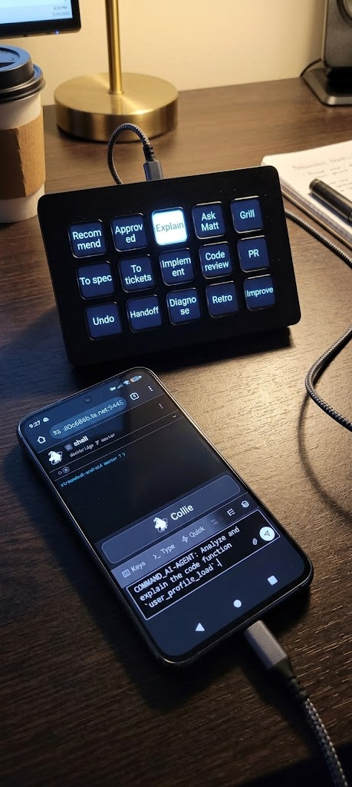

# SD Bridge

**Your AI coding agent, one keypress away.**

Turn a physical Stream Deck into a command pad for AI agents on Android. Approve changes, trigger skills, review code, and steer your workflow without typing every prompt.

  

## Get started

1. [Download the APK](https://github.com/Meisburg/streamdeck-bridge/releases).
2. Open SD Bridge, tap **Deck setup**, then **Enable typing service**.
3. Enable SD Bridge in Android Accessibility settings.
4. Connect your Stream Deck via USB and grant permission.
5. Open your AI agent, focus its input field, and press a key.

**Requires:** Android 9+, USB host support, a compatible Stream Deck, and a USB adapter or cable.

## What can you do?

**Plan. Build. Review. Ship.**

The 15 customizable keys cover the AI coding workflow, from turning ideas into specs and tickets to implementation, code review, and pull requests.

| Plan | Build | Improve |
|---|---|---|
| Recommend | Write a spec | Undo |
| Approve | Create tickets | Hand off |
| Explain | Implement | Diagnose |
| Interview | Review code | Retrospect |
| Challenge | Prepare a PR | Improve architecture |

Every key sends custom text or a slash command supported by your agent. The default slash commands use [Matt Pocock's skills](https://github.com/mattpocock/skills).

## Privacy

No networking, telemetry, or analytics. Commands are stored locally. Accessibility access locates the focused text field and enters your configured text.

## Troubleshooting

* **Nothing types:** Reenable the SD Bridge accessibility service.
* **Blank key labels:** Open **Deck setup** and tap **Re-arm keys**.
* **Build fails:** Run `./build.sh`, which pins JDK 21.

## How it works

SD Bridge communicates directly with the Stream Deck over USB and types into the focused Android text field. Submission via Enter or a send button is supported where available.

## License

MIT. Not affiliated with or endorsed by Elgato.
