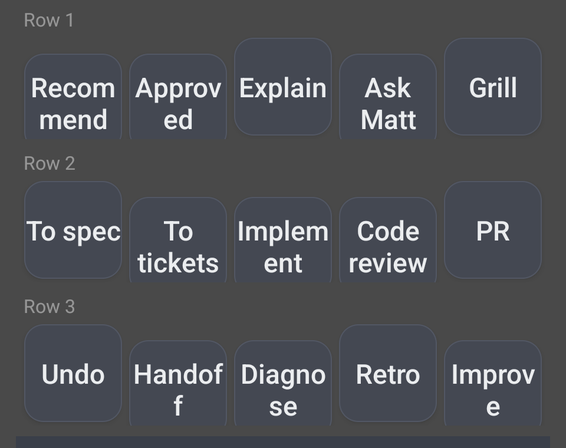

# SD Bridge (Stream Deck Bridge)

<p align="center">
  
</p>

<p align="center">
  <em>A physical deck, an Android phone, and a cable. Press a key, and the text lands in your agent.</em>
</p>

---

Turn an Elgato Stream Deck into a macro pad for your **Android phone**. Press a
physical deck key, and pre-written text lands in whatever app is focused: a chat
app, an AI agent, a notes field, anywhere you'd otherwise type.

Built for people who want one-tap commands without unlocking, hunting for an app,
and typing on a phone keyboard.

---

## What it does

<p align="center">
  
</p>

<p align="center">
  <em>15 on-screen keys, mirrored to 15 physical deck keys.</em>
</p>

- **Two surfaces, one set of commands.** A 15-key tap grid in the app (works with
  no hardware at all, from a phone in your pocket), and the same 15 commands bound
  to the physical keys of a USB Stream Deck.
- **Your labels show up on the deck.** Each physical key is a little LCD, and it
  displays its own label, so the hardware tells you what each key does instead of
  you having to remember positions.
- **Send a prompt, or launch a capability.** A key can send any text, including
  your agent's slash commands or skills. Press a key, and the capability runs. That
  turns the deck into a launcher for the handful of agent actions you actually use,
  instead of a text pad.
- **Tap a key to edit it.** No long-press-to-edit dance, no separate config screen.
- **Long-press a key** for Edit / Clear / Send-as-is.
- **Send confirmation.** After every send the app posts a notification telling you
  what it typed and whether it landed, because the app backgrounds itself to send.
- **Brightness control** for the deck backlight, to save battery. Persisted, so it
  survives replugs and reboots.
- **No root.** No ADB required for normal use. No accounts, no network calls, no
  analytics.

---

## Requirements

- An Android phone with **USB host support** (OTG). Most modern phones have it; if
  yours doesn't, the tap grid still works perfectly.
- An **Elgato Stream Deck** (MK.2 and the 15-key models are what this was developed
  and tested against).
- Android 9.0 (API 29) or newer.
- A USB-C to USB-A adapter or cable that fits your phone, ideally with PD
  passthrough if you want to charge while the deck is attached.

---

## Install

Build it yourself; there is no Play Store listing.

```bash
git clone https://github.com/Meisburg/streamdeck-mobile
cd streamdeck-mobile
./build.sh
adb install app/build/outputs/apk/debug/app-debug.apk
```

`build.sh` pins JDK 21 by path. If you use plain `./gradlew` instead and your
machine's default Java is 26 or newer, the build fails with a message that names
neither Java nor the version problem:

```
java.lang.IllegalArgumentException: 26.0.2.1
```

That is the Kotlin Gradle plugin failing to parse a four-part version string. Use
`./build.sh`, or point `org.gradle.java.home` at a JDK 21 install.

Or open the folder in Android Studio and hit Run.

### First-run setup

1. Open **SD Bridge**.
2. Tap **Deck setup**, then **Enable typing service**.
3. In the Android Settings screen that opens, find **SD Bridge** and turn it on.
   Android will warn you about what an accessibility service can do. See the
   disclosure below for exactly what this one does.
4. Plug in your Stream Deck. Android asks for USB permission: allow it.

That's it. The binding persists across reboots.

> **Do not clear the app's data** (or run `adb shell pm clear`) unless you are
> prepared to re-do step 3. Android wipes the accessibility grant along with the
> data, and **nothing** can restore it programmatically: not the app, not ADB.
> That restriction is deliberate, and it is why the toggle is a manual step.

---

## Daily use

There is nothing to press before a send.

1. Open the app you want text to land in (a chat app, your agent, anything).
2. Tap its text field.
3. Press a key, on the phone screen or the physical deck.

If labels ever go blank after unplugging and replugging, tap **Deck setup** and use
**Re-arm keys**. It also re-arms itself automatically after a period of silence.

---

## Chatting with your AI agent from the deck

This is the use case the app was built for, so it is worth spelling out.

The idea: **your agent is a conversation, and a conversation is mostly a handful of things you say over and over.** "What do you recommend?" "Continue." "Explain that more simply." "Undo that." Typing those on a phone keyboard is friction, and friction is what stops you from steering the agent at all. So each one becomes a physical key.

### Why a deck instead of just typing

The agent workflow has a shape. You align on what to build, you break it into work, you build it, you review it, you ship it. That is four or five phases, and while you are *in* a phase you say the same few things: approve, continue, explain, undo.

A key removes the typing, the unlocking, and the app-switching, which matters most in the two situations where you would otherwise not bother:

- You are **away from the desk**, phone in hand, and want to keep a build moving.
- You are **mid-flow** and the agent just did something you want to redirect.

The deck does not make the agent smarter. It removes the cost of steering it, so you steer it more.

### The one thing to understand first

A key can send **any text**. Plain words, or a slash command.

- Plain words (`approved`, `undo that last change`) are just a message. The agent reads them like anything you typed.
- A slash command (`/to-spec`, `/handoff`) triggers a named capability in the agent's own harness.

Nothing special is needed to support slash commands. The text is typed and submitted like any other entry. But it is the interesting half: it means a key can launch a *capability*, not just say something.

**A slash key only works if your agent actually has that skill installed.** If it does not, the key types a line the agent cannot interpret, which looks like the key failing. Every slash command below names a skill from [mattpocock/skills](https://github.com/mattpocock/skills); install that set first, or edit the keys to match whatever your agent answers to.

### Setup

Nothing beyond the normal install. Because the app sends to whatever is focused, the sequence is:

1. Open your agent (a chat app, a terminal running a coding agent, a web UI).
2. Tap its text field so the cursor is in it.
3. Press a key.

The app never needs to know which agent you use. It types into the focused field and submits.

If your agent runs in a **terminal**, see `DeckKeyboardService` in the repository layout: terminal apps often accept input only from an active IME, so there is an optional keyboard path for that case.

---

## The 15 default commands

The defaults are not a random list of macros. They are **the phases of building a feature, in the order the phases happen**, laid out so the physical position of a key tells you where you are.

Row 1 aligns on what to build. Row 2 specifies, tickets, implements, reviews, ships. Row 3 is the row of things that are *not* part of the build: recover, pause, repair, reflect, improve.

```
Row 1   Recommend   Approved   Explain     Ask Matt   Grill
Row 2   To spec     To tickets Implement   Code review  PR
Row 3   Undo        Handoff    Diagnose    Retro      Improve
```

Every key is editable. These are a starting point, and the whole point of the app is that you replace them with your own.

### Row 1 — align on what to build

| Key | Sends | What it is for |
| :--- | :--- | :--- |
| **Recommend** | `what do you recommend?` | Forces a decision out of the agent instead of a menu. |
| **Approved** | `approved` | The most-pressed key on the deck. Says yes and moves on. |
| **Explain** | `explain as simply and succinctly as possible` | Re-pitches something that did not land. |
| **Ask Matt** | `/ask-matt` | Routes to the right skill in the set below, when you are not sure which one you want. |
| **Grill** | `/grill-with-docs` | Relentless interview about a plan or design, which also builds the project's glossary and ADRs as it goes. |

`Ask Matt` and `Grill` are the two halves of the same idea: `ask-matt` is the router, and `grill-with-docs` is the one you end up in most often. The point of a grilling session is to close the gap between what you think you asked for and what the agent understood, before any code exists.

### Row 2 — spec, ticket, build, review, ship

| Key | Sends | What it is for |
| :--- | :--- | :--- |
| **To spec** | `/to-spec` | Turns the conversation you just had into a written spec. No interview, just synthesis. |
| **To tickets** | `/to-tickets` | Breaks that spec into tracer-bullet tickets, each declaring what blocks it. |
| **Implement** | `/implement-spec` | Builds a whole spec, working the tickets as a task graph. |
| **Code review** | `/code-review` | Two-axis review of the diff: does it follow the repo's standards, and does it match the spec. |
| **PR** | `/pr` | Shapes the pull request body: the smallest visual that makes the change clear, before/after evidence, and a merge-danger call. |

> **Keep Row 1 in one unbroken context window.** `ask-matt`, `grill-with-docs`, `to-spec` and `to-tickets` are meant to build on the same thinking. Do not compact or clear the conversation between them. That is why those four are the four keys of row 1 rather than spread across rows.

### Row 3 — leave the build

| Key | Sends | What it is for |
| :--- | :--- | :--- |
| **Undo** | `undo that last change` | Says "that worked, and I did not want that." Not a `git revert`; it is a message to the agent. |
| **Handoff** | `/handoff` | Compacts the conversation so a fresh agent can continue. For running out of context, or getting pulled away mid-task. |
| **Diagnose** | `/diagnosing-bugs` | Disciplined debugging loop for the hard ones: build a loop that goes red on this bug, then fix it. |
| **Retro** | `/retro` | After a build, suggests changes to the *agent's environment*: navigation, checks, standards, tooling. |
| **Improve** | `/improve-codebase-architecture` | Surveys the codebase for deepening opportunities. Worth running every few days. |

Every key in rows 1 and 2 ends by *changing something*. Row 3 is the row that can take it back, pause it, repair it, and make the next build start from a better place.

### The skills behind the slash keys

All slash keys come from [mattpocock/skills](https://github.com/mattpocock/skills), a set of small composable engineering skills. Install that set in your agent of choice; the README there covers it. The specific ones this deck uses:

`ask-matt` · `grill-with-docs` · `to-spec` · `to-tickets` · `implement-spec` · `code-review` · `pr` · `handoff` · `diagnosing-bugs` · `retro` · `improve-codebase-architecture`

Two of these are deliberately **not** on the deck: `grilling` and `codebase-design` can be reached for automatically by the agent, so they do not need a physical key.

### Making it yours

The defaults are one workflow. Yours will differ.

Tap any key to edit it. Long-press for **Edit / Clear / Send as-is**. Two fields matter:

- **Button name** — what the key face shows. Keep it short; it auto-sizes to fit, but shorter is more readable at a glance.
- **Text to send** — the literal text, or the slash command.

If most of your keys end up being plain phrases you type a lot ("looks good, continue", "check that against the spec"), that is the app working as intended.

---

## The accessibility disclosure

This app asks for an **accessibility service**, which is the same permission
screen readers use. That is genuinely powerful, so here is exactly what this app
does with it, and what it does not do.

**It does:**
- Read the current screen to find the focused text field.
- Insert the text you pre-configured into that field.
- Press Enter, or tap a send button, if you enabled that per command.

**It does not:**
- Send anything anywhere. There is **no networking code in this app at all**. No
  servers, no telemetry, no analytics, no crash reporting.
- Record, store, or log what is on your screen. Text is read to find a target and
  discarded.
- Talk to accounts or credentials of any kind.

The only thing it ever types is text you typed into its own editor. Everything is
stored locally in the app's private data directory.

Being blunt about the tradeoff: an accessibility service that reads the screen is
a category of software you should grant deliberately. Read the source if you want
to confirm the claims above; it is a small app.

---

## Security note: the broadcast receiver

The app exposes one receiver so a computer can trigger a command over ADB:

```bash
adb shell am broadcast -a com.hermes.deckbridge.SEND \
  -n com.hermes.deckbridge/.CommandReceiver \
  --es text "hello there" \
  --es target discord
```

Because that receiver injects text into whatever is focused, it would be a
text-injection primitive if any app could call it. It is guarded by a **sender
UID check in code**: only this app's own UID, root, and the ADB shell UID are
accepted. Ordinary third-party apps are refused and logged.

A note for anyone tempted to "improve" this by moving the guard into the manifest
as an `android:permission` with `protectionLevel="signature"`: **do not**. That was
tried and measured. On a real device (Pixel 9 Pro, Android 15) a signature-level
permission is *silently dropped* for the shell UID, so `am broadcast` reports
`Broadcast completed: result=0` while the receiver never runs. `signatureOrSystem`
fails the same way; granting it with `pm grant` also fails. It works on an
emulator, which is exactly what makes it a nasty trap. The in-code check works on
hardware and is the reason it is written that way.

---

## How the deck protocol works

Documented here because it is the part that took the longest to work out, and the
next person should not have to rediscover it.

- **The deck is not a keyboard.** Android has no driver for it, and it will not be
  treated as a standard HID input device. Its input endpoint cannot be read with
  plain blocking reads on Android; they return `-1` forever.
- **The deck must be woken** with a feature report before it sends key reports.
- **Key payload lands one byte per key at offset `+0x04`** of a 512-byte input
  report.
- **Key images are rotated 180 degrees** relative to what you send.
- **MTP fights you for the device.** The `com.android.mtp` stack grabs the deck via
  a wildcard USB filter. The app detaches it, which is why the "which app owns this
  USB device" question matters.
- **Two dispatchers are required:** one to keep the USB link alive, one to re-arm
  after failures.

The app handles all of this; this section exists for people modifying it.

---

## Known limitations

Honest list, not a wish list.

- **Some apps cannot confirm a send.** Text arrives, but the app cannot always
  tell whether the send button registered, so the notification says
  `typed (submit unconfirmed)`. Discord is one of these.
- **Sends into a web-app composer can be slow.** Some apps reflow their text field
  between the moment it is located and the moment it is tapped, so the app retries.
  Budget a few seconds for those.
- **Deck key input on some phones is flaky at the USB level.** The read loop
  occasionally returns nothing and needs a re-arm, which the app does automatically.
  Swapping the cable is the usual real fix.
- **One phone port, two needs.** If the deck occupies your only USB-C port, use
  **wireless ADB** for computer-side work and keep the deck on the phone. If you
  need to charge at the same time, use a USB-C hub with PD passthrough.
- **No `configChanges` on the main activity**, so rotating the phone recreates it.
  Commands are safe; in-memory log lines are not.
- **If typing stops working, the app tells you.** A resident service watches the
  accessibility binding and raises a notification with a tap straight into the
  setting that fixes it. It deliberately does not steal focus to do this: an earlier
  version did, and it threw you out of Settings faster than you could reach the
  toggle.
- **The deck's USB link degrades under load**, so a key press can occasionally go
  silent until the app re-arms. `Deck setup` has a **Re-arm keys** button, and it
  also re-arms itself after a period of quiet. If it happens often, the cable is
  the usual culprit.

---

## Repository layout

```
app/src/main/java/com/hermes/deckbridge/
  MainActivity.kt              UI: the 15-key grid, editor, setup screen
  CommandStore.kt              Command model + persistence (15 fixed slots)
  CommandReceiver.kt           ADB/broadcast entry point (UID-guarded)
  DeckAccessibilityService.kt  The core: targeting, typing, submitting
  DeckTransport.kt             USB HID: bring-up, read loop, brightness, re-arm
  DeckProtocol.kt              The HID protocol itself: reports, key images, wake
  KeyImage.kt                  Draws each key face as a JPEG for the hardware
  DeckResidentService.kt       Keeps the process alive; hosts the watchdog
  DeckSettings.kt              Persisted deck settings (brightness, rotation)
  DeckKeyboardService.kt       Optional IME path for terminal apps
  ImeSwapper.kt                Swaps the active IME per press
  BootReceiver.kt              Re-arms on boot and after an update
  SendConfirm.kt               The post-send notification
  MacroStore.kt                Key-to-action mapping, persisted as JSON
  UsbProbe.kt                  Diagnostic: reports what the USB stack actually does
```

The last two are worth knowing about even if you never touch them. `MacroStore`
is the mapping layer between a key and its action, stored as editable JSON in the
app's private directory, which is what makes the deck scriptable from a
workstation. `UsbProbe` exists because `controlTransfer` calls were timing out at
exactly the read timeout, and a guess about why would have been wrong.

---

## License

MIT. See [LICENSE](LICENSE).

## Icon and trademark

The icon is an original mark: a bridge span over five key-lights, drawn for this
project. It is yours to keep or replace under the MIT license.

This project is **not affiliated with, endorsed by, or sponsored by Elgato.** "Elgato"
and "Stream Deck" are trademarks of Elgato Systems, and they are used here only to
say what hardware this works with, which is normal and permitted. No Elgato artwork
is included in this repository.

If you fork this, you can rename and re-icon it freely; nothing in the code depends
on the name or the mark.
